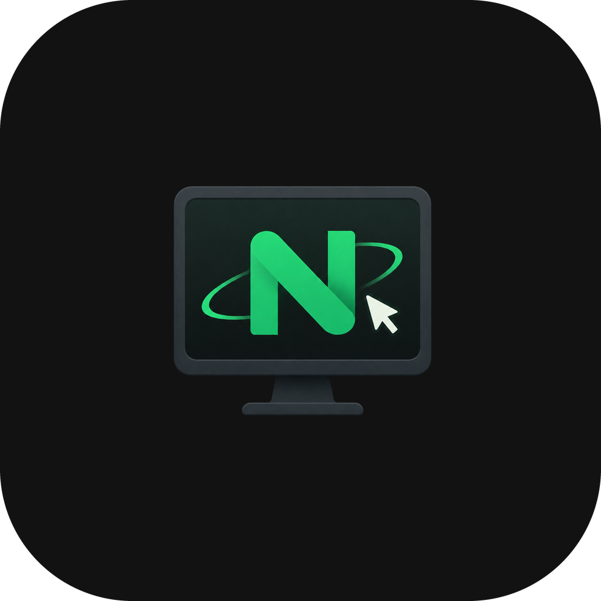

<div align="center">



# NeoDesk

**A RustDesk Android client with a UI redesigned to my taste.**

</div>

## About

NeoDesk is an Android remote-desktop client built on RustDesk's engine. It
keeps RustDesk's protocol and speed and replaces the client UI and gestures.

> Controlling side only (Android). The controlled machine runs regular RustDesk
> or a compatible host.

## Download

Get the latest `neodesk-*.apk` from
[Releases](https://github.com/Kobayashi2003/NeoDesk/releases) and install it on
an arm64 Android device.

## Build

Requires Flutter 3.24.5 on `PATH` (or `$env:FLUTTER_HOME`). No Rust toolchain:
the engine (`librustdesk.so`) is taken from RustDesk's official release APK.

```powershell
.\scripts\build.ps1               # sync, analyze + test, release build -> dist\neodesk-<version>.apk
.\scripts\build.ps1 debug         # debug build
.\scripts\build.ps1 -SkipTests    # skip analyze + tests
```

`rustdesk/` is generated from upstream RustDesk plus `overlay/` and `patches/`;
see [AGENTS.md](AGENTS.md).

## Docs (Chinese)

- [代码结构](docs/代码结构.md) — file tree with each file's role
- [已实现功能](docs/已实现功能.md) — implemented features
- [拟实现功能](docs/拟实现功能.md) — planned work and verification debt

## What I wrote

The UI and gesture system (`neodesk_core/`), and the adapter and launcher that
bind it to RustDesk's engine (`overlay/lib/neodesk/`). The rest is upstream
RustDesk.

## Thanks

Built on [RustDesk](https://github.com/rustdesk/rustdesk). Many thanks to the
RustDesk project.
